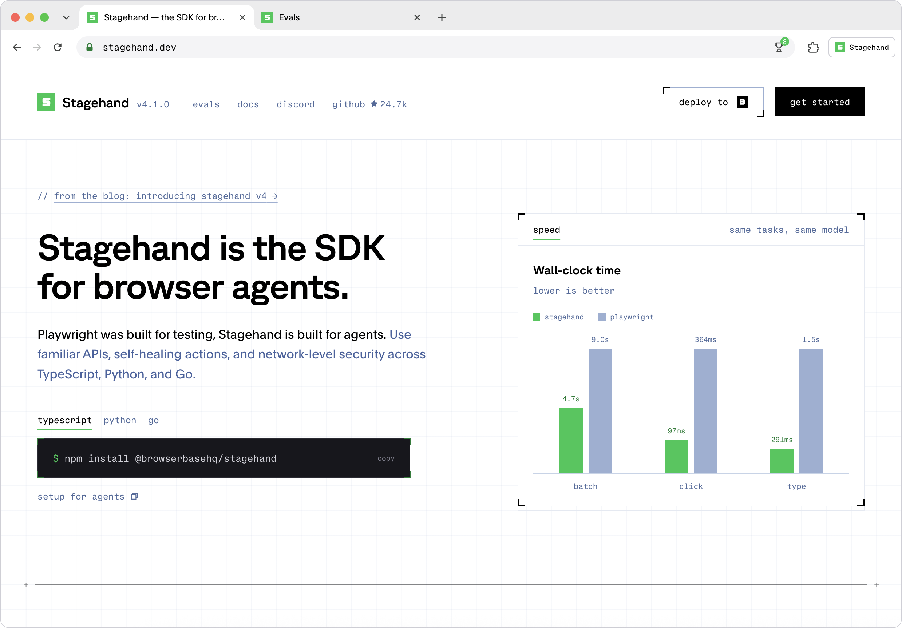

<div id="toc" align="center" style="margin-bottom: 0;">
  <ul style="list-style: none; margin: 0; padding: 0;">
    <a href="https://stagehand.dev">
      <picture>
        <source media="(prefers-color-scheme: dark)" srcset="https://raw.githubusercontent.com/browserbase/stagehand/main/media/dark_logo.png" />
        
      </picture>
    </a>
  </ul>
</div>
<p align="center">
  <strong>Stagehand is the SDK for browser agents</strong><br>
</p>

<p align="center">
  <a href="https://trendshift.io/repositories/12122" target="_blank"></a>
</p>

<p align="center">
  <a href="https://docs.stagehand.dev"><strong>Docs</strong></a> ·
  <a href="https://docs.stagehand.dev/v4/first-steps/quickstart"><strong>Quickstart</strong></a> ·
  <a href="https://github.com/browserbase/stagehand"><strong>⭐ Star this repo</strong></a>
</p>

<p align="center">
  <a href="https://github.com/browserbase/stagehand/tree/main?tab=MIT-1-ov-file#MIT-1-ov-file">
    <picture>
      <source media="(prefers-color-scheme: dark)" srcset="https://raw.githubusercontent.com/browserbase/stagehand/main/media/dark_license.svg" />
      
    </picture>
  </a>
  <a href="https://discord.gg/stagehand">
    <picture>
      <source media="(prefers-color-scheme: dark)" srcset="https://raw.githubusercontent.com/browserbase/stagehand/main/media/dark_discord.svg" />
      
    </picture>
  </a>
  <a href="https://deepwiki.com/browserbase/stagehand">
    
  </a>
</p>

<p align="center">
  <a href="https://stagehand.dev">
    
  </a>
</p>

# Stagehand Python SDK

## AI that uses the browser like humans.

Sign in once, keep the session, and pull structured data out the other side.

Replace `app.example.com` with your application's URL and set `OPENAI_API_KEY`, `APP_EMAIL`, and
`APP_PASSWORD` before running this example.

```python
import asyncio
import os

from pydantic import BaseModel
from stagehand import Stagehand, local_browser


class Invoice(BaseModel):
    number: str
    amount: float
    paid: bool


class Invoices(BaseModel):
    invoices: list[Invoice]


async def main() -> None:
    # Cookies persist in ./browser-data, so the next run starts already signed in
    browser = await local_browser.launch(user_data_dir="./browser-data")
    try:
        stagehand = await Stagehand.create(
            browser=browser,
            model="openai/gpt-5.4-mini",
            model_api_key=os.environ["OPENAI_API_KEY"],
        )
        try:
            page = (await browser.context.pages())[0]
            await page.goto("https://app.example.com/login")

            # observe() returns real selectors, so credentials never reach the model
            email = await stagehand.observe("find the email input")
            password = await stagehand.observe("find the password input")
            await page.locator(email.data[0].selector).fill(os.environ["APP_EMAIL"])
            await page.locator(password.data[0].selector).fill(os.environ["APP_PASSWORD"])

            # act() self-heals when the site redesigns its form
            await stagehand.act("click the sign in button")
            await stagehand.act("open the billing page")

            # extract() returns schema-validated data
            result = await stagehand.extract(
                "extract every invoice in the table",
                Invoices,
            )
            print(result.data.invoices)
        finally:
            await stagehand.close()
    finally:
        await browser.close()


asyncio.run(main())
```

## Install

```bash
pip install stagehand
```

Requires Python 3.11 or later. Local runs need [Chrome](https://www.google.com/chrome/) installed.
Full setup: [Quickstart](https://docs.stagehand.dev/v4/first-steps/quickstart).

## Why Stagehand

- **Familiar APIs:** The Playwright-style methods you and your agents already know: `goto`, `click`, `locator`, `screenshot`.
- **Token efficiency:** Hybrid accessibility-tree trimming gives agents exactly the page context they need and nothing more.
- **Faster in production:** Stagehand runs as an extension next to the browser, cutting round-trip latency on every action.
- **Self-healing:** `act`, `observe`, and `extract` refresh how an action happens when the site changes underneath it.
- **Built for agents:** WebMCP, clipboard support, batch commands, deep locators for nested iframes and closed Shadow DOMs, OTel traces.
- **Three languages:** One complete browser driver across TypeScript, Python, and Go.

## Run it on Browserbase

Point the same script at [Browserbase](https://www.browserbase.com). The
[Model Gateway](https://docs.stagehand.dev/v4/configuration/models#model-gateway) handles model
routing, and [server-side caching](https://docs.stagehand.dev/v4/best-practices/caching) reuses
results for repeated actions.

Import `browserbase` from `stagehand`, then use these browser and client setup calls inside the
async `main()` above, keeping its `try`/`finally` cleanup:

```python
from stagehand import browserbase

browser = await browserbase.launch(api_key=os.environ["BROWSERBASE_API_KEY"])
stagehand = await Stagehand.create(browser=browser, cache=True)
```

Use `browserbase.connect(api_key=..., session_id=...)` to attach to an existing session.
`browser.close()` releases the Browserbase session. For a `keep_alive=True` session, use
`await browser.disconnect()` to close the client and connection while keeping the session for later.
See [browser configuration](https://docs.stagehand.dev/v4/configuration/browser) for more options.

## Search and fetch without a browser

[Fetch](https://docs.stagehand.dev/v4/add-ons/fetch) grabs the content of a URL as markdown.
[Search](https://docs.stagehand.dev/v4/add-ons/search) provides fast, token-efficient web search
results. Both complement browser sessions without launching a browser.

```python
import asyncio
import os

from stagehand import browserbase


async def search_and_fetch() -> None:
    results = await browserbase.search(
        api_key=os.environ["BROWSERBASE_API_KEY"],
        query="browser agent frameworks",
        num_results=5,
    )
    fetched = await browserbase.fetch(
        api_key=os.environ["BROWSERBASE_API_KEY"],
        url=results.results[0].url,
        format="markdown",
    )
    print(fetched.content)


asyncio.run(search_and_fetch())
```

## Python API notes

`Stagehand.act()`, `Stagehand.observe()`, and `Stagehand.extract()` use the active page by
default. Pass `page=page` to target a specific SDK `Page`.

`Page.goto()`, `reload()`, `go_back()`, and `go_forward()` return the main-document `Response`,
or `None` when navigation does not produce one. Response bodies and complete headers are retrieved
lazily while the Stagehand session remains open.

When contributing examples or tests, keep browser ownership explicit: launch or connect a
browser handle, pass it to `Stagehand.create()`, close Stagehand first, and close the browser in
the outermost `finally` block.

## Docs and resources

- [Python examples](https://github.com/browserbase/stagehand/tree/main/packages/sdk-python/examples): actions, extraction, observation, and custom LLM usage.
- [Page](https://docs.stagehand.dev/v4/reference/page) and [locator](https://docs.stagehand.dev/v4/reference/locator): Playwright-style browser and element APIs.
- [Integrations](https://docs.stagehand.dev/v4/integrations/overview): agent frameworks and coding agents.
- [Main README](https://github.com/browserbase/stagehand/blob/main/README.md): project overview, MCP setup, and community links.

## Contributing

Clone the [Stagehand repository](https://github.com/browserbase/stagehand) and run these commands
from its root. All Python projects share the root uv workspace, `uv.lock`, and `.venv`.
`just install` installs all workspace members, and consumers use this SDK from source.
See [the contributing guide](https://github.com/browserbase/stagehand/blob/main/CONTRIBUTING.md)
for workspace membership and package-specific commands.

```bash
# Install uv
curl -LsSf https://astral.sh/uv/install.sh | sh

# Install just
brew install just

just install
just generate
just check
just test
just build
```
